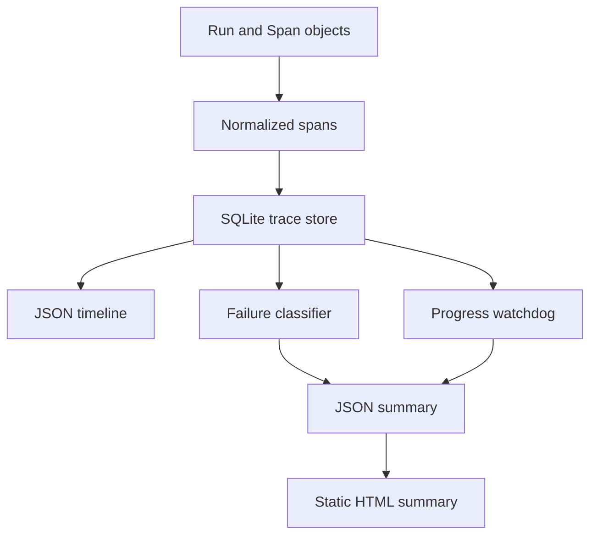

# Agent Trace Debugger

[](https://github.com/MadanMohan0537/agent-trace-debugger/actions/workflows/ci.yml)

**Local Python library for scripted agent traces: an ordered timeline, a failure class on failed runs, cost per successful task, and a flag when actions add no milestone.**

The repository is `agent-trace-debugger`. The installable package and the CLI are still called `traceloom`. The HTML page heading is `TraceLoom`.

## Problem and who it's for

Agent logs are usually a wall of prompts and tool results. Operators can't quickly find the broken step, tell an expensive success from a cheap failure, or catch a loop where every action looks different. This is for teams building agents and the AI PMs and operations leads who have to explain why a run failed and what it cost.

## Approach

- A normalized **span schema** (`run_id`, `span_id`, `sequence`, `kind`, `name`, start, duration, tokens, `cost_usd`, `status`, optional `milestone`, `input`, `output`). The fixtures use kinds `model` and `tool`. A plan is a model span named `plan`. `TraceStore` writes spans to **SQLite**, replaces a run id on re-ingest, and reads them back ordered by `sequence`. Replay returns the recorded input and output. It does not re-run tools.
- A small **failure taxonomy** in `traceloom/classifier.py`. Successful runs get no class (`null` in JSON). A failed run takes the first match: `infinite_loop` (semantic watchdog), `timeout`, `refusal` (span status `refused`), `bad_arguments`, `wrong_tool`, `silent_wrong_answer` (failed run whose spans are all `ok`), otherwise `unknown`.
- **Cost per successful task** is total span cost divided by the number of successful runs. When none succeed, the JSON value is `null`.
- A **semantic-progress watchdog** (`window=3`, `grace_actions=1` by default) flags a window of `model` and `tool` spans with no milestone. `repeated_tool_loop` flags three identical tool names in a row. Scores are fields on the JSON report. Nothing sends a notification.



## What exists today

The only CLI command is `traceloom demo`. It ingests the five runs built in `traceloom/fixtures.py` and writes `report.json` and `report.html`. External log import and live ingestion are not implemented.

Those fixtures:

- `run-001` succeeds (`Find and summarize policy`) with milestones `planned`, `source_found`, and `completed`.
- `run-002` fails. After the plan it calls `lookup`, `reroute`, `notify`, and `replan`, and only the plan span has a milestone. The class is `infinite_loop`.
- `run-003` fails on a tool span with status `timeout`.
- `run-004` fails on a model span with status `refused`. The class is `refusal`.
- `run-005` succeeds (`Research options`) after three `search` calls and still records milestone `source_found`.

`traceloom demo` prints this summary. Every fixture span costs `0.0002` USD and 120 tokens. The prices are synthetic.

| Field | Value |
|---|---|
| runs | 5 |
| successes | 2 |
| success_rate | 0.4 |
| total_cost_usd | 0.0034 |
| total_tokens | 2040 |
| cost_per_success_usd | 0.0017 |
| failure_mix | `infinite_loop` 1, `timeout` 1, `refusal` 1 |
| classification_coverage | 1.0 |

`classification_coverage` is the share of failed runs whose class is not `unknown`. Failure classes are assigned only to failed runs. Both successes have `failure: null`. The HTML page shows success rate as `40%` and cost per success as `$0.0017`.

Watchdog scores on the same five fixtures are stored at `watchdog_experiment` in `report.json`:

| Method | Counts | Recall | False-alert rate |
|---|---|---|---|
| semantic progress | 1 true positive, 0 false positives, 0 false negatives | 1.0 | 0.0 |
| repeated tool | 0 true positives, 1 false positive (`run-005`), 1 false negative (`run-002`) | 0.0 | 0.25 |

`report.json` holds the summary, those scores, and each run's span timeline. `report.html` is a static page with the run count, success rate, cost per success, and a table of id, task, success, failure, and total latency. Span timelines and watchdog scores stay in the JSON file.

`wrong_tool`, `bad_arguments`, and `silent_wrong_answer` exist as classifier branches. The fixtures and the tests cover success, `infinite_loop`, `timeout`, and `refusal`.

The suite is 9 tests in `tests/test_core.py` (`python -m unittest discover -s tests -v`). [`.github/workflows/ci.yml`](.github/workflows/ci.yml) runs that command on Python 3.11, 3.12, and 3.13.

## How success would be measured

| Measure | Status |
|---|---|
| Loops caught by the semantic watchdog versus repeated-tool detection, on real agent traces | Not yet measured |
| Share of failed runs that receive a specific class other than `unknown`, on real agent traces | Not yet measured |
| Time for an operator to find the failing step | Not yet measured |
| Cost per successful task on real agent traffic, tracked across releases | Not yet measured |

The table in [What exists today](#what-exists-today) is the scripted demo printing its own fixtures. That output is not a measurement of real runs.

## Limitations

- Fixture prices are synthetic and must not be read as vendor pricing.
- Classification follows the recorded span status and the run success flag. It does not decide whether a tool choice was appropriate.
- Milestones have to be supplied on the spans. Missing milestones make the watchdog flag the window. The default window of 3 and grace of 1 are the function defaults, not calibrated thresholds.
- The HTML writer formats cost per success as a number, so that page expects at least one success. The JSON field is `null` when there are none.
- Live OpenTelemetry ingestion, a hosted UI, automatic redaction, and a retention policy are not in this repo. Stored `input` and `output` can contain secrets. The HTML file has no authentication.
- The CLI loads the in-repo fixtures only.

See [docs/ARCHITECTURE.md](docs/ARCHITECTURE.md) and [docs/BACKLOG.md](docs/BACKLOG.md). Rows below the shipped watchdog in the backlog are proposals.

## Quick start

Requires Python 3.11+. The package declares no runtime dependencies. The demo needs no API key, model download, or paid service. A fresh `pip install -e .` can still fetch the `setuptools` build dependency.

```bash
git clone https://github.com/MadanMohan0537/agent-trace-debugger.git
cd agent-trace-debugger
python -m venv .venv
source .venv/bin/activate
python -m pip install -e .
python -m unittest discover -s tests -v
traceloom demo --db traceloom.db --json report.json --html report.html
```

Open `report.html` in a browser. `traceloom.db`, `report.json`, and `report.html` are local outputs listed in `.gitignore`.

## Deployment

Cloudflare Workers is the planned target. It is not configured in this repository, and this project is not deployed.

When a Worker exists, the deploy command is:

```bash
npx wrangler deploy
```

There is no `wrangler.toml` yet, so that command has nothing to deploy. Still needed:

- `wrangler.toml`
- A Worker entry point
- Python Workers, or a JavaScript/TypeScript port of this package

The code in the repo is a local CPython package. It stores traces with the standard-library `sqlite3` module.

## License

MIT. See [LICENSE](LICENSE).
